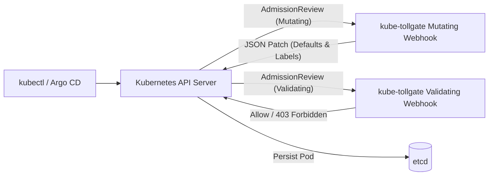

# kube-tollgate

Kubernetes Dynamic Admission Controller for FinOps Budget & Policy Enforcement.

`kube-tollgate` is a Kubernetes-native admission controller (mutating and validating webhook) designed to eliminate resource waste, enforce cost-allocation metadata, and prevent budget overruns before workloads are admitted into the cluster.

---

## Key Features

- **Automated Default Injection (Mutating Webhook):** Automatically injects baseline CPU and Memory requests and limits into unbounded containers, preventing cluster node starvation and unexpected autoscaler scale-ups.
- **Cost Tag Inheritance & Validation:** Propagates mandatory FinOps labels (such as `cost-center`, `team`, `environment`) from parent namespaces and rejects non-compliant workloads.
- **Dynamic Namespace Budget Guard (Validating Webhook):** Evaluates aggregate namespace resource consumption in real-time, blocking deployments that exceed allocated budget ceilings.
- **Limit-to-Request Ratio Enforcement:** Restricts overcommit margins to prevent noisy-neighbor syndrome and unpredictable OOM kills.
- **Zero-Friction Local Development:** Includes self-signed TLS bootstrapper for automated local testing with k3d or Kind without requiring cert-manager.
- **Built-in Prometheus Telemetry:** Exposes comprehensive metrics for admission decisions, rejection reasons, and namespace budget utilization.

---

## Architecture Overview



For comprehensive architectural design and functional specifications, refer to the project documentation:
- Architecture & MVP Boundaries: [PROJECT.md](../.docs/PROJECT.md)
- Technical & API Specification: [PROJECT-SPEC.md](../.docs/PROJECT-SPEC.md)
- Development Roadmap: [TODO.md](../.docs/TODO.md)

---

## Custom Resource: TollgatePolicy

`kube-tollgate` is configured via the `TollgatePolicy` custom resource:

```yaml
# API Version: finops.tollgate.io/v1alpha1
# Kind: TollgatePolicy
apiVersion: finops.tollgate.io/v1alpha1
kind: TollgatePolicy
metadata:
  name: default-budget-policy
  namespace: team-billing
spec:
  mode: Enforce
  labels:
    required:
      - key: "cost-center"
        pattern: "^CC-[0-9]{4}$"
      - key: "team"
      - key: "environment"
        pattern: "^(production|staging|development)$"
    autoInject:
      enabled: true
      inheritFromNamespace: true
      defaults:
        cost-center: "CC-9999"
        environment: "development"
  resources:
    defaults:
      requests:
        cpu: "100m"
        memory: "128Mi"
      limits:
        cpu: "500m"
        memory: "512Mi"
    maxAllowedPerPod:
      cpu: "4"
      memory: "8Gi"
    maxRatio:
      cpu: 4.0
      memory: 2.0
  budget:
    aggregateRequests:
      cpu: "32"
      memory: "64Gi"
```

