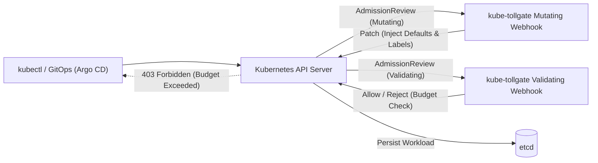
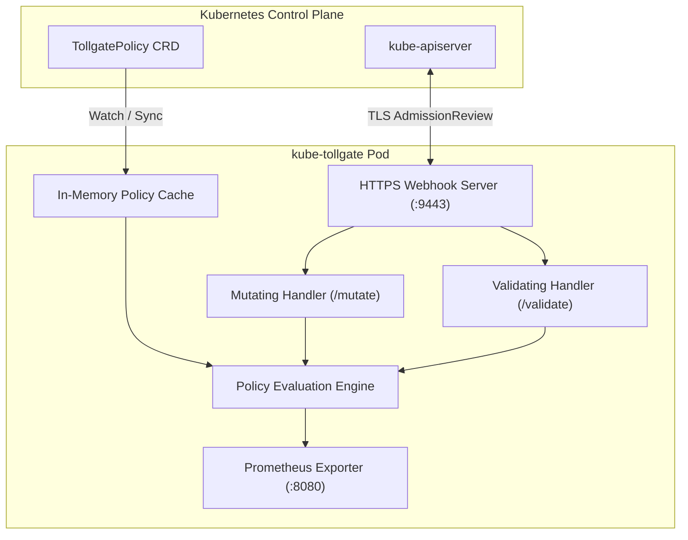

# kube-tollgate

Kubernetes Dynamic Admission Controller for FinOps Budget & Policy Enforcement.

`kube-tollgate` is a Kubernetes-native admission controller operating as both a mutating and validating webhook. It acts as an automated FinOps checkpoint before workloads are admitted into the cluster, eliminating resource waste, enforcing cost-allocation tags, and preventing namespace budget overruns.

---

## Key Features

- **Automated Default Injection (Mutating Webhook):** Automatically injects baseline CPU and Memory requests and limits into unbounded containers, preventing cluster node starvation and unexpected cloud autoscaling.
- **Cost Tag Inheritance & Validation:** Propagates mandatory FinOps labels (such as `cost-center`, `team`, `environment`) from parent namespaces and rejects non-compliant workloads.
- **Dynamic Namespace Budget Guard (Validating Webhook):** Evaluates aggregate namespace resource consumption in real time, blocking deployments that exceed allocated budget ceilings with actionable HTTP 403 rejection messages.
- **Limit-to-Request Ratio Enforcement:** Restricts overcommit margins to prevent noisy-neighbor syndrome and unpredictable OOM kills.
- **Zero-Friction Local Development:** Built-in self-signed TLS bootstrapper generates ephemeral certificates and patches webhook configurations on startup without requiring external cert-manager.
- **Built-in Prometheus Telemetry:** Exposes comprehensive metrics for admission decisions, evaluation latencies, rejection reasons, and namespace budget utilization ratios.

---

## Architecture Overview

`kube-tollgate` intercepts incoming workload admission reviews at the Kubernetes API Server boundary:



### Component Structure



---

## Custom Resource: TollgatePolicy

`kube-tollgate` policies are defined per namespace via the `TollgatePolicy` custom resource:

```yaml
# API Version: finops.tollgate.io/v1alpha1
# Kind: TollgatePolicy
apiVersion: finops.tollgate.io/v1alpha1
kind: TollgatePolicy
metadata:
  name: default-budget-policy
  namespace: team-billing
spec:
  # Mode of enforcement: "Enforce" (reject violations) or "Audit" (allow with warnings)
  mode: Enforce

  # Cost allocation label policies
  labels:
    required:
      - key: "cost-center"
        pattern: "^CC-[0-9]{4}$"
      - key: "team"
      - key: "environment"
        pattern: "^(production|staging|development)$"
    autoInject:
      enabled: true
      inheritFromNamespace: true
      defaults:
        cost-center: "CC-9999"
        environment: "development"

  # Container resource guardrails
  resources:
    defaults:
      requests:
        cpu: "100m"
        memory: "128Mi"
      limits:
        cpu: "500m"
        memory: "512Mi"
    maxAllowedPerPod:
      cpu: "4"
      memory: "8Gi"
    maxRatio:
      cpu: 4.0
      memory: 2.0

  # Namespace aggregate budget quota
  budget:
    aggregateRequests:
      cpu: "32"
      memory: "64Gi"
```

---

## Quickstart & Local Development

### Prerequisites

- Go (1.23+)
- Docker (24+)
- k3d (v5.6+)
- kubectl (v1.30+)

### Building and Testing

```bash
# Build the binary
make build

# Run unit tests with race detection
make test

# Run linter checks
make lint

# Generate CRD manifests and deepcopy code
make generate manifests
```

### Local Cluster Deployment with k3d

To stand up a fully functional local development cluster with self-signed TLS and webhooks:

```bash
# Automated single-command dev environment
./hack/local-dev.sh
```

Or step-by-step using Makefile:

```bash
# 1. Create k3d cluster
make cluster-up

# 2. Build local Docker image
make docker-build

# 3. Import image into k3d
make cluster-import

# 4. Deploy CRD, RBAC, Webhooks, and Controller Manager
make deploy
```

---

## Example Scenarios

Demonstration manifests are provided in the `examples/` directory:

| Scenario Manifest | Description | Expected Outcome |
|---|---|---|
| `examples/01-valid-pod.yaml` | Pod satisfying required labels, resource limits, and budget | Admitted immediately |
| `examples/02-unbounded-pod-mutated.yaml` | Pod with no resources and missing labels | Mutated by `/mutate`: defaults injected |
| `examples/03-budget-exceeded-rejected.yaml` | Pod requesting 34 cores CPU (budget ceiling is 32 cores) | Rejected with HTTP 403 `BUDGET_EXCEEDED` |
| `examples/04-missing-labels-rejected.yaml` | Pod with invalid labels in a non-autoInject namespace | Rejected with HTTP 403 `MISSING_OR_INVALID_LABEL` |

### Testing an Example

```bash
# 1. Apply policy and namespace
kubectl apply -f examples/00-policy.yaml

# 2. Test valid pod
kubectl apply -f examples/01-valid-pod.yaml

# 3. Test unbounded pod mutation
kubectl apply -f examples/02-unbounded-pod-mutated.yaml
kubectl get pod unbounded-worker-mutated -n team-billing -o yaml

# 4. Test budget rejection
kubectl apply -f examples/03-budget-exceeded-rejected.yaml
```

When a pod is rejected, `kube-tollgate` returns a structured rejection message:

```text
[kube-tollgate] Admission Denied:
  Namespace: team-billing
  Resource: Pod/oversized-budget-breaker
  Reason: BUDGET_EXCEEDED
  Details:
    - Current Namespace CPU Allocation: 0.50 cores
    - Requested by Pod: 34.00 cores
    - Budget Ceiling: 32.00 cores
    - Exceeded by: 2.50 cores
  Action Required:
    - Downsize container requests in pod spec or request a quota increase in TollgatePolicy 'default-budget-policy'.
```

---

## Observability & Telemetry

`kube-tollgate` exposes Prometheus metrics on HTTP port `:8080/metrics` and health endpoints on `:8080/healthz` and `:8080/readyz`:

| Metric Name | Type | Labels | Description |
|---|---|---|---|
| `tollgate_admission_requests_total` | Counter | `handler`, `operation`, `decision`, `namespace` | Total number of admission requests processed |
| `tollgate_admission_duration_seconds` | Histogram | `handler`, `operation` | Latency distribution of admission evaluations |
| `tollgate_mutations_applied_total` | Counter | `type`, `namespace` | Count of mutations applied (`injected_cpu_request`, `injected_label`) |
| `tollgate_rejections_total` | Counter | `reason`, `namespace`, `resource_kind` | Count of rejected admissions partitioned by reason |
| `tollgate_namespace_budget_requests_ratio` | Gauge | `namespace`, `resource` | Current aggregate requests vs budget ceiling ratio (0.0 - 1.0+) |
| `tollgate_policy_sync_total` | Counter | `status` | Count of policy sync/reconciliation cycles |

---

## Technical Lessons Learned (Gotchas)

> [!NOTE]
> **Controller-Runtime Transitive Dependencies & Linter Memory:**
> Enabling `govet: enable-all: true` or SSA-based linters (`unused`, `unparam`) with massive Kubernetes dependency graphs can cause significant memory allocation during static analysis. Restricting vet analyzers to standard checks and using dedicated fast linters (`ineffassign`, `revive`, `staticcheck`) keeps linting fast and memory usage below 2 GB.

> [!TIP]
> **Self-Signed CA Injection Timing:**
> The TLS bootstrapper runs before the webhook server binds its port. The subsequent webhook configuration patching runs as a `manager.Runnable` after cache synchronization, preventing race conditions with kube-apiserver availability.

> [!WARNING]
> **Namespace Webhook Recursion Prevention:**
> Both `MutatingWebhookConfiguration` and `ValidatingWebhookConfiguration` explicitly exclude the `kube-system` and `tollgate-system` namespaces using `namespaceSelector`. This prevents deadlocks during cluster bootstrap or webhook restarts.
